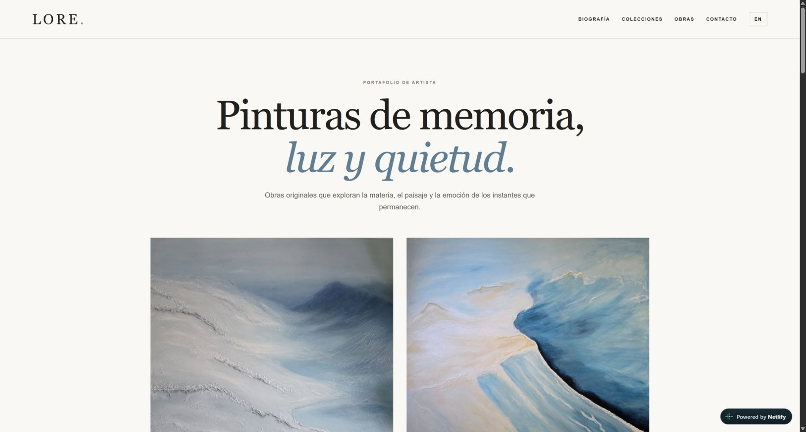

# LORE Art Studio

A bilingual artist portfolio website showcasing 22 original artworks through a responsive, editorial-style experience. The project was designed and developed as a lightweight static website for LORE, with a focus on visual storytelling, accessibility, and straightforward browsing across desktop and mobile devices.

## Live website

[Visit LORE Art Studio](https://loreartstudio.com)



## Project goals

LORE Art Studio provides a professional online home for the artist's work while keeping the experience fast, calm, and easy to navigate. Visitors can explore collections, filter the complete gallery, switch between Spanish and English, and open individual artwork details without leaving the page.

## Features

- Gallery featuring 22 original artworks
- Responsive layout for desktop, tablet, and mobile screens
- Spanish and English interface with instant language switching
- Artwork filters for abstraction, Mediterranean scenes, landscapes, figurative work, and floral compositions
- Individual artwork views with title, collection, medium, and reference number
- Collection cards that take visitors directly to a filtered gallery
- Accessible semantic structure, descriptive image alternatives, and keyboard-friendly controls
- Direct contact with the artist via email
- Custom domain and HTTPS deployment on Netlify

## Technologies

- **HTML5** for semantic page structure
- **CSS3** for the visual system, responsive grids, transitions, and modal presentation
- **Vanilla JavaScript** for gallery rendering, filters, bilingual content, and artwork dialogs
- **Netlify** for static hosting, custom-domain delivery, DNS, and TLS

No framework, package manager, build tool, or third-party JavaScript library is required.

## Project structure

```text
lore-art-studio/
├── assets/
│   ├── work_01.jpg
│   ├── ...
│   └── work_22.jpg
├── docs/
│   └── lore-art-studio-preview.png
├── .gitignore
├── ARTWORK-RIGHTS.md
├── index.html
└── README.md
```

The production page is intentionally self-contained: its HTML, CSS, artwork metadata, translations, and JavaScript are maintained in `index.html`. The `assets` directory contains the optimized artwork photographs used by the gallery.

## Run locally

Because this is a static website, no installation or build step is needed.

1. Clone or download the repository.
2. Open the project directory.
3. Start any local static server, for example:

   ```bash
   python -m http.server 8000
   ```

4. Open `http://localhost:8000` in a browser.

Opening `index.html` directly also works for a quick preview, although a local server is recommended for development and testing.

## Deployment

The public website is hosted on Netlify and available at [loreartstudio.com](https://loreartstudio.com). This repository is intended as a portfolio and source-code showcase. It is not automatically connected to the production Netlify deployment.

## Artwork and copyright

All paintings, artwork photographs, titles, and associated artistic content are the exclusive property of **LORE**. All rights are reserved.

Publishing the website source code does **not** grant permission to copy, reproduce, distribute, modify, train models on, exhibit, sell, license, or otherwise use the artworks or their photographs. See [ARTWORK-RIGHTS.md](ARTWORK-RIGHTS.md) for details.

No open-source license has been applied to this repository.

## Contact

For artwork availability, documentation, or professional enquiries, contact [loreartstudio7@gmail.com](mailto:loreartstudio7@gmail.com).
